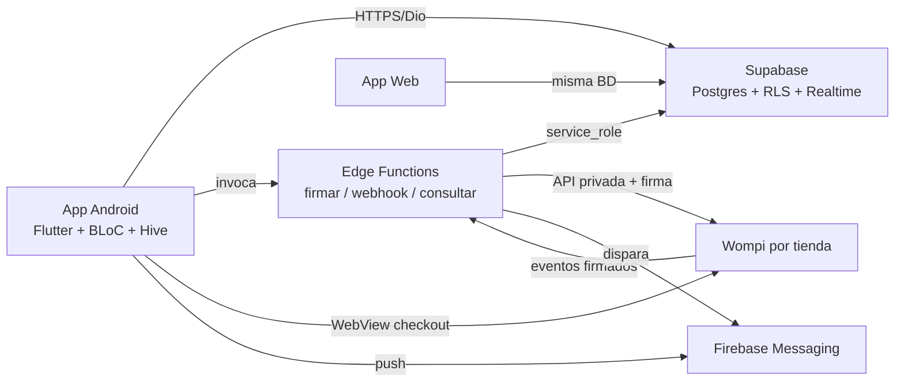
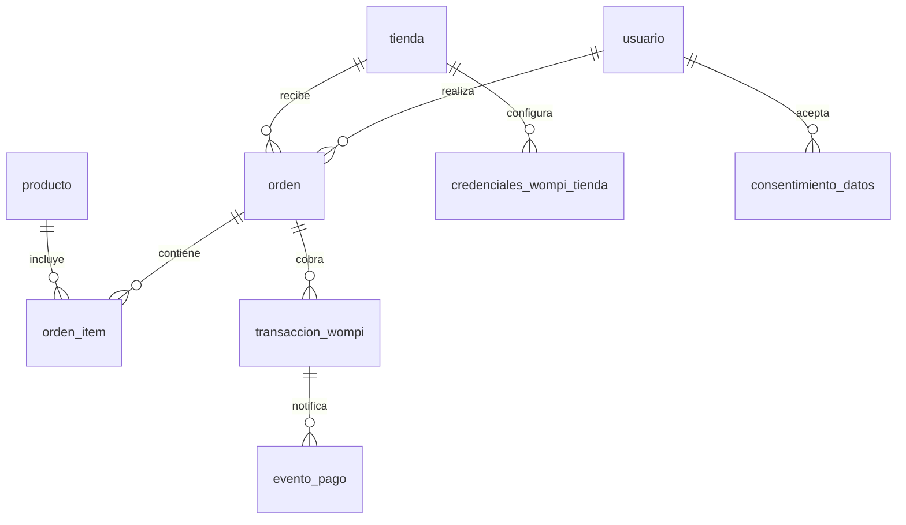
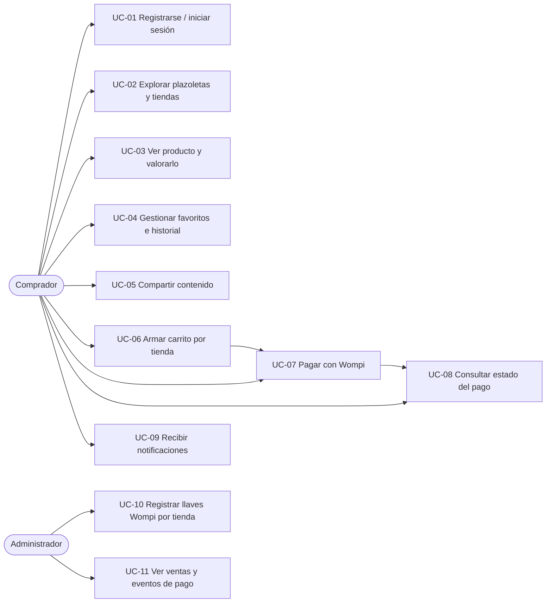

# Ingeniería y Arquitectura de Software
## Paseo del Comercio — Aplicación Móvil Android (Flutter)

**Asignatura:** Ingeniería de Software — Primer Semestre, Ingeniería de Sistemas
**Proyecto:** `paseo-del-comercio-app-mobile-flutter`
**Versión del documento:** 1.0 — 26/09/2026
**Fase:** Planeación del proyecto (diseño)

---

## 1. Especificación de Requisitos (SRS)

### 1.1 Requisitos funcionales
| ID | Requisito | Actor |
|---|---|---|
| RF-01 | Registro, login (correo, Google, Microsoft), sesión persistente, perfil y modo invitado | Comprador |
| RF-02 | Listar y ver detalle de plazoletas (tiendas, imágenes, mapa) | Comprador |
| RF-03 | Listar y ver detalle de tiendas (horarios, contacto, redes, etiquetas) | Comprador |
| RF-04 | Listar y ver detalle de productos (precio, imágenes, características, valoraciones) | Comprador |
| RF-05 | Listar y ver detalle de organizaciones (tiendas agrupadas, miembros) | Comprador |
| RF-06 | Marcar y listar favoritos de tiendas y productos por usuario | Comprador registrado |
| RF-07 | Valorar productos y registrar interacciones/estadísticas | Comprador registrado |
| RF-08 | Historial local de visitas, compartir contenido, mapa embebido | Comprador |
| RF-09 | Notificaciones, ajustes (tema, caché), soporte y legales | Comprador |
| RF-10 | Sincronización con app web (misma BD, imágenes multi-CDN) | Sistema |
| RF-11 | Carrito por tienda, órdenes y checkout Wompi por comercio (firma en servidor, webhook, estados PENDING/APPROVED/DECLINED/VOIDED/ERROR) | Comprador registrado |
| RF-12 | Notificación push del estado del pago con deep link al pedido | Comprador registrado |

### 1.2 Requisitos no funcionales
| ID | Categoría | Requisito y meta |
|---|---|---|
| RNF-01 | Portabilidad | Android 8.0+ desde una sola base Flutter |
| RNF-02 | Desempeño | Arranque < 2 s; imagen < 500 ms; pantallas < 2 s en 4G |
| RNF-03 | Disponibilidad | Offline-first (Hive, TTL 1 h, 100 MB); el pago exige conexión |
| RNF-04 | Escalabilidad | Backend serverless (Supabase + Edge Functions, plan gratis) |
| RNF-05 | Seguridad | Llaves Wompi solo en servidor; RLS por usuario/tienda; montos recalculados en servidor; aritmética en centavos enteros |
| RNF-06 | Usabilidad | Tema oscuro dorado, español CO, deep links, accesibilidad básica |
| RNF-07 | Mantenibilidad | Clean Architecture 4 capas, BLoC, GetIt, lints; coverage ≥ 70% en pagos |
| RNF-08 | Confiabilidad | Webhook idempotente (un `evento_id` = un procesamiento); respaldo por consulta de estado |
| RNF-09 | Observabilidad | Logs de funciones + `trigger_logs` + auditoría de pagos |
| RNF-10 | Legalidad | Aceptación habeas data (tokens Wompi) registrada por usuario; términos en la app |

---

## 2. Arquitectura de Software y Diseño

### 2.1 Stack tecnológico
| Capa | Selección | Alternativas descartadas |
|---|---|---|
| App | Flutter 3.7+ (Dart), BLoC + GetIt + GoRouter + Hive | React Native; nativo Kotlin |
| Backend/BD | Supabase Postgres + Auth + Storage + Realtime; Edge Functions (Deno/TS) | Backend propio; Firestore |
| Auth social | Firebase Auth (Google, Microsoft) | Auth0; login propio |
| Pagos | Wompi Widget/WebView por tienda (llave pública, privada, integridad, eventos) | API directa (fase futura); otra pasarela |
| Push | Firebase Cloud Messaging | OneSignal; solo email |
| Imágenes | Cloudflare R2 → S3 → Supabase → asset local | Un solo origen |

### 2.2 Diagrama de arquitectura


### 2.3 Modelo de datos (ER)
Base existente: 22 tablas (`usuario`, `tienda`, `producto`, `plazoleta`, `organizacion`, imágenes, etiquetas, horarios, valoraciones, notificaciones… — ver `doc/3_DATABASE/ESQUEMA_BASE_DATOS.md`). **No se modifica ninguna.** Se agregan 6 tablas del dominio de pagos:



```sql
CREATE TABLE orden (
    id BIGSERIAL PRIMARY KEY, usuario_id INT NOT NULL REFERENCES usuario(id),
    tienda_id INT NOT NULL REFERENCES tienda(id),
    total_centavos BIGINT NOT NULL CHECK (total_centavos > 0),
    moneda VARCHAR(3) NOT NULL DEFAULT 'COP',
    estado VARCHAR(20) NOT NULL DEFAULT 'borrador'
        CHECK (estado IN ('borrador','pendiente_pago','pagada','rechazada','expirada')),
    referencia VARCHAR(64) NOT NULL UNIQUE, creado_en TIMESTAMPTZ DEFAULT NOW()
);
CREATE TABLE orden_item (
    id BIGSERIAL PRIMARY KEY, orden_id BIGINT NOT NULL REFERENCES orden(id) ON DELETE CASCADE,
    producto_id INT NOT NULL REFERENCES producto(id),
    cantidad INT NOT NULL CHECK (cantidad > 0), precio_centavos BIGINT NOT NULL
);
CREATE TABLE credenciales_wompi_tienda (
    id BIGSERIAL PRIMARY KEY, tienda_id INT NOT NULL UNIQUE REFERENCES tienda(id) ON DELETE CASCADE,
    ambiente VARCHAR(10) NOT NULL DEFAULT 'sandbox' CHECK (ambiente IN ('sandbox','produccion')),
    public_key TEXT NOT NULL, private_key_enc TEXT NOT NULL,
    integrity_enc TEXT NOT NULL, events_enc TEXT NOT NULL,
    activa BOOLEAN NOT NULL DEFAULT FALSE
);
CREATE TABLE transaccion_wompi (
    id BIGSERIAL PRIMARY KEY, orden_id BIGINT NOT NULL REFERENCES orden(id) ON DELETE CASCADE,
    tienda_id INT NOT NULL REFERENCES tienda(id), id_wompi VARCHAR(64),
    referencia VARCHAR(255) NOT NULL UNIQUE, monto_centavos BIGINT NOT NULL,
    estado VARCHAR(20) NOT NULL DEFAULT 'PENDING'
        CHECK (estado IN ('PENDING','APPROVED','DECLINED','VOIDED','ERROR')),
    metodo_pago VARCHAR(50), payload JSONB, creado_en TIMESTAMPTZ DEFAULT NOW()
);
CREATE TABLE evento_pago (
    id BIGSERIAL PRIMARY KEY, transaccion_id BIGINT REFERENCES transaccion_wompi(id) ON DELETE CASCADE,
    tienda_id INT NOT NULL REFERENCES tienda(id), evento_id_wompi VARCHAR(128) UNIQUE,
    verificado BOOLEAN DEFAULT FALSE, procesado BOOLEAN DEFAULT FALSE,
    payload JSONB NOT NULL, recibido_en TIMESTAMPTZ DEFAULT NOW()
);
CREATE TABLE consentimiento_datos (
    id BIGSERIAL PRIMARY KEY, usuario_id INT NOT NULL REFERENCES usuario(id) ON DELETE CASCADE,
    tipo VARCHAR(40) NOT NULL, texto_version VARCHAR(20) NOT NULL,
    aceptado BOOLEAN NOT NULL, fecha TIMESTAMPTZ DEFAULT NOW()
);
```
RLS: `credenciales_wompi_tienda` sin acceso a clientes (solo `service_role`); `orden`/`transaccion_wompi` visibles a su dueño y a su tienda.

### 2.4 Diagramas de casos de uso
Actores: **Comprador** (invitado o registrado) y **Administrador** (opera comercios y llaves).



| ID | Caso de uso | Flujo principal resumido |
|---|---|---|
| UC-01 | Registrarse / iniciar sesión | Elige correo, Google o Microsoft → sesión persistente; invitado explora sin comprar |
| UC-02 | Explorar plazoletas y tiendas | Lista plazoletas → detalle con tiendas → detalle de tienda (horarios, contacto, mapa) |
| UC-03 | Ver producto y valorarlo | Detalle (precio, fotos, características) → califica si está registrado |
| UC-04 | Favoritos e historial | Marca favoritos (nube) y revisa historial local y "mis favoritos" |
| UC-05 | Compartir contenido | Comparte tienda/producto por link (deep link de retorno) |
| UC-06 | Armar carrito por tienda | Agrega productos de una tienda; total en centavos; edita cantidades |
| UC-07 | Pagar con Wompi | Acepta contratos habeas data → servidor firma → checkout Wompi en WebView → retorno a la app |
| UC-08 | Consultar estado del pago | Pantalla de resultado consulta al servidor; reintenta si sigue PENDING |
| UC-09 | Recibir notificaciones | Push del cambio de estado (webhook) con deep link al pedido; centro in-app |
| UC-10 | Registrar llaves Wompi | Admin guarda pública/privada/integridad/eventos por tienda (servidor, cifradas) |
| UC-11 | Ver ventas y eventos | Admin/tienda consulta órdenes, transacciones y eventos conciliados |

### 2.5 Diseño de interfaz (mockups)
Referencia base: `doc/PROPUESTAS_UI.md` (tema oscuro dorado). Pantallas nuevas del flujo de compra:
```
[Carrito]                    [Checkout]                  [Resultado]
Tienda: Café San José        Orden PDC-12-1718           ✅ Pago aprobado
- Café 500g x2  $36.000     Total: $36.000              Ref: PDC-12-1718
- Panela x1      $8.500     [x] Acepto contratos Wompi   [Ver pedido]
Total:          $44.500     [Pagar $44.500]             [Seguir comprando]
[Vaciar] [Pagar →]
```
Wireframes detallados y sistema de diseño se mantienen en `doc/PROPUESTAS_UI.md`; estas 3 pantallas siguen sus componentes (`ProductoCard`, botones dorados, héroes con imagen resiliente).

*Fin del documento.*
